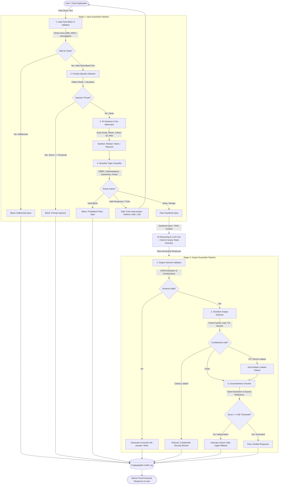
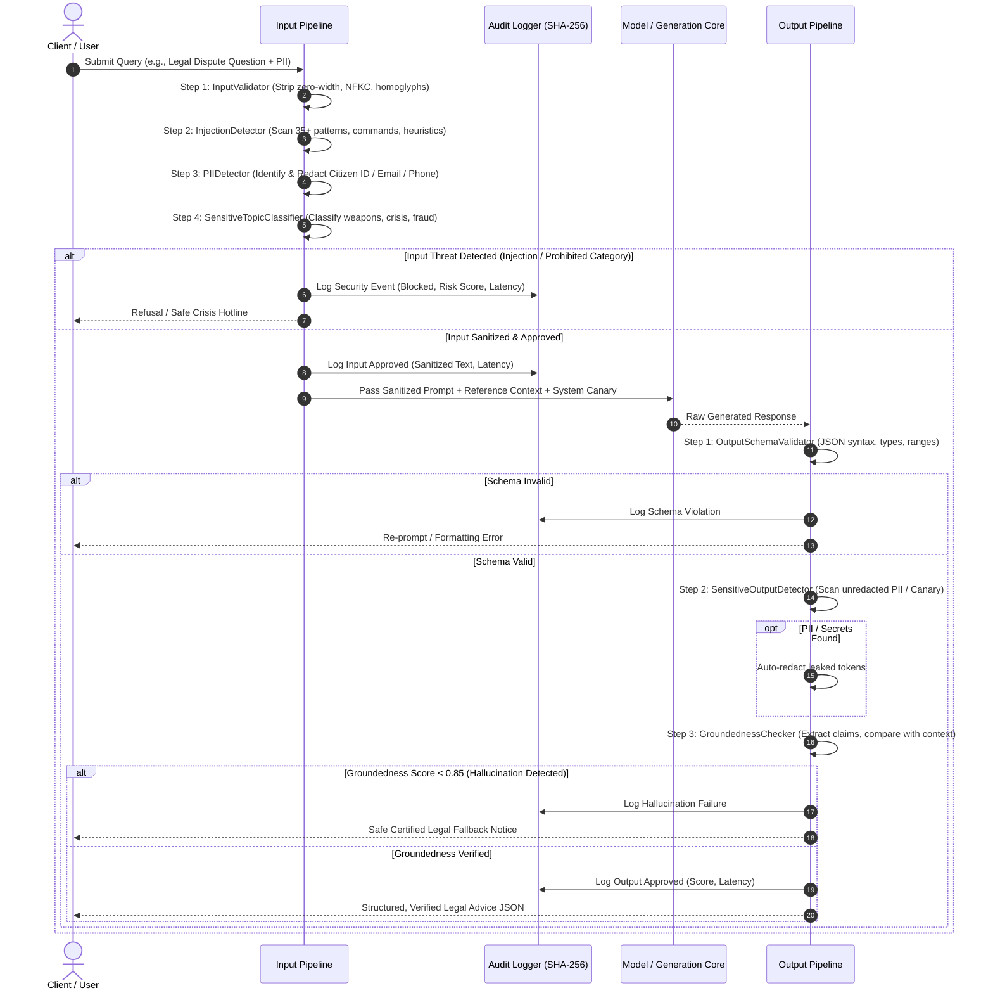
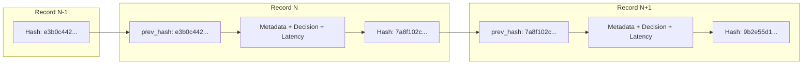

# System Architecture: Nyaya-Guard

## Overview
**Nyaya-Guard** is a dual-stage, defense-in-depth trustworthy AI guardrail architecture engineered specifically for high-assurance AI applications (demonstrated on the **Nepal Legal & Compliance AI Assistant** domain).

The architecture enforces strict safety, security, and privacy boundaries across two distinct checkpoints:
1. **Input Guardrail Pipeline (Pre-Ingestion Gate)**: Sanitizes and evaluates user prompts *before* they can reach the underlying model or reasoning engine.
2. **Output Guardrail Pipeline (Post-Generation Gate)**: Evaluates and remediates model responses *before* they are delivered to the user.

---

## 1. End-to-End Architectural Flow Diagram

---

## 2. Component Interaction & Lifecycle Sequence

---

## 3. Defense Stages & Control Points

### Stage 1: Input Guardrail Controls
| Control Point | Detection Mechanism | Action on Flag | Architectural Rationale |
| :--- | :--- | :--- | :--- |
| **Input Validator** | Unicode NFKC, zero-width stripping, Cyrillic/Greek homoglyph map | Rejects malformed / null bytes; normalizes clean text | Prevents encoding-based bypasses from evading subsequent regex and NLP detectors |
| **Prompt Injection Detector** | 35+ compiled patterns (Direct override, DAN mode, Prompt extraction, Impersonation, Context delimiters) + Shannon entropy | Immediate hard block (`block_injection`) | Prevents malicious user control over system instructions, tool execution, or confidential leaks |
| **PII Detector & Vault** | Multi-entity regex for emails, phone numbers (+977 / US / Intl), citizenship numbers, PAN, SSN, passports | In-place Redaction, Masking, or Tokenization | Protects user privacy before data leaves the trust boundary; complies with Privacy Acts |
| **Sensitive Topic Classifier** | Keyword and pattern matching across 6 critical safety categories | `hard_block` for prohibited harms; `safe_response` for self-harm/crisis | Enforces strict public safety; routes individuals in distress to certified emergency helplines (1166) |

### Stage 2: Output Guardrail Controls
| Control Point | Detection Mechanism | Action on Flag | Architectural Rationale |
| :--- | :--- | :--- | :--- |
| **Schema Validator** | Markdown fence stripping, JSON parsing, field type & range checking | Corrective re-prompt generation / Regeneration | Protects downstream UI and API consumers from crash bugs caused by malformed or non-JSON output |
| **Sensitive Output Detector** | Secondary PII scan, secret/API key scanner, system canary token monitor | In-place redaction for PII; Immediate refusal if canary leaks | Defense-in-depth: prevents model memorization leakage and verifies system prompt confidentiality |
| **Groundedness Checker** | Atomic claim extraction, n-gram overlap, entity preservation against source context | Substitution with verified Safe Fallback response | Prevents dangerous legal hallucinations, fabricated case citations, or non-existent statutory sections |

---

## 4. Cryptographic Audit Log Architecture

The system maintains a tamper-evident audit record in `logs/guardrails_audit.jsonl` using **SHA-256 hash chaining**:

- Any post-hoc modification or record deletion breaks the cryptographic chain immediately.
- The `AuditLogger.verify_integrity()` utility traverses the log and guarantees audit validity.
